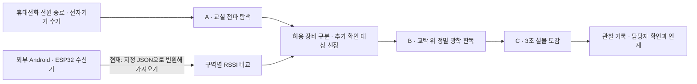

# ExamGuard

**수능·국가고시·학교 시험에서 스마트안경을 이용한 부정행위의 단서를 찾고, 감독관의 실물 확인까지 연결하는 오픈소스 프로젝트입니다.**

출발점은 **교실에 남아 있는 무선 통신 단서를 먼저 확인하는 것**입니다. 그다음 추가 확인할 기기를 좁히고, 교탁 위 광학 판독과 실물 도감으로 어떤 기기인지 대조합니다.

[웹앱 사용하기](https://epoko77-ai.github.io/examguard/#wireless) · [모드 A와 제조사 코드 설명](docs/MODE_A.md) · [기존 도구 연결 구조](docs/INTEGRATIONS.md) · [기여하기](CONTRIBUTING.md)

> **현재 상태:** 작동하는 웹 프로토타입입니다. 브라우저 BLE 이름 조건 탐색·선택 기록과 이름 기반 의심 후보 표시, 광학 검사, 사진 도감 검색, 외부 RSSI 비교와 **광고 패킷 복합 필터**를 제공합니다. 복합 필터는 가져온 회사 ID·UUID·바이트를 사용자가 제공한 규칙으로 대조합니다. 실기기로 검증한 기본 규칙, 교실 전체 광고 자동 수집, 페어링/인터넷 사용 판별은 아직 없습니다.

## 어떤 기기·브라우저로 열어야 하나요?

**별도 ExamGuard 앱 다운로드 없이 [웹 주소](https://epoko77-ai.github.io/examguard/#wireless)로 사용합니다.** 홈 화면에 추가하는 것은 선택 사항이며, 브라우저의 Bluetooth 제한을 없애지는 않습니다.

| 사용 기기 | 여는 브라우저 | A · Bluetooth 탐색 | B · 광학 검사 / C · 도감 |
| --- | --- | --- | --- |
| Android 휴대전화 | **Chrome 앱을 직접 실행** | 지원 환경에서 이용 | 이용 가능 |
| iPhone·iPad | **Safari** | **기본 미지원. 일반 iOS용 Chrome도 동일** | 이용 가능 |
| iPhone·iPad · BLE 대안 | **Bluefy 별도 설치** | 시도 가능한 실험적 경로. **ExamGuard 실기기 호환성 미검증** | Safari 이용 권장 |
| Windows 10/11·macOS | **Chrome 또는 Edge** | Bluetooth 어댑터·권한 필요 | 이용 가능 |
| Chromebook | **Chrome** | Bluetooth 어댑터·권한 필요 | 이용 가능 |

- **Android:** 카카오톡·네이버·SNS 안에서 열린 화면이라면 주소 복사 → Chrome 앱 실행 → 주소창에 붙여넣기 → Bluetooth 켜기 → 요청되는 권한 허용 → 준비 항목 3개 확인 → **교실 스캔 시작**.
- **iPhone·iPad:** Safari에서 접속 → **B · 광학 검사**에서 카메라 권한 허용 또는 사진 열기 → **C · 도감·사진 대조**. Bluetooth 탐색은 **별도 Bluefy 브라우저로 시도**할 수 있습니다. **Safari로 변경하거나 홈 화면에 설치하는 것으로 BLE 기능이 생기지는 않습니다.**
- **PC:** 지원 브라우저에서 HTTPS 주소를 열고 Bluetooth 설정과 어댑터를 확인합니다. Safari·Firefox는 BLE 탐색을 지원하지 않습니다. Linux의 기본 환경도 권장하지 않습니다.

**아이폰에서 BLE 탐색을 시도하는 순서:** [Bluefy 설치(App Store)](https://apps.apple.com/kr/app/bluefy-web-ble-browser/id1492822055) → Bluefy 앱 직접 실행 → ExamGuard 주소 붙여넣기 → Bluetooth 켜기·Bluefy 권한 허용 → 준비 항목 3개 확인 → **교실 스캔 시작**. Bluefy의 Web Bluetooth 제공은 [개발사 공식 안내](https://bluefy.app/guide.html)에서 확인했습니다. **ExamGuard와 실제 iPhone/Bluefy에서의 선택창·광고 탐색·사진 대조 동작은 아직 검증하지 않았습니다.** 앱은 실제 API가 제공되면 iOS라는 이유로 막지 않으며, 기기 선택 성공이나 전체 기기 발견을 보장하지 않습니다. 동작하지 않으면 Android Chrome 또는 지원 PC를 이용하세요. Bluefy는 제3자 브라우저이며 별도 이용·개인정보 정책을 적용합니다.

카메라 조명은 기기별 지원 여부가 다르며, 사진 대조는 첫 실행 때 약 104 MB를 내려받습니다. 앱은 실제 Bluetooth API 제공 여부를 확인해 접속 안내와 대체 기능을 표시합니다. 지원 브라우저라도 학교 관리 정책·하드웨어·권한 때문에 탐색이 제한될 수 있습니다. [Chrome 공식 지원 환경](https://developer.chrome.com/docs/capabilities/bluetooth) · [MDN 호환성](https://developer.mozilla.org/en-US/docs/Web/API/Web_Bluetooth_API#browser_compatibility)


## 왜 만들었나요?

스마트안경은 일반 안경과 닮은 외형에 카메라·마이크·스피커·디스플레이를 넣을 수 있습니다. 감독관이 모든 기종을 외우거나 외형만 보고 전자 기능을 구분하기는 어렵습니다. 그렇다고 교실의 안경을 모두 촬영하는 것부터 시작하면 점검 부담이 커집니다.

시험장의 첫 방어선은 **휴대전화 전원 종료와 전자기기 수거**입니다. 이를 확인한 뒤에도 남아 있는 기기의 무선 신호는 추가 점검의 단서가 됩니다. 스마트안경이 스마트폰을 거쳐 외부 AI·조력자에게 질문을 보내거나 답을 받는 방식이라면, 안경과 연결 기기 사이의 Bluetooth 등 통신 경로부터 살펴보는 것이 합리적입니다.

다만 모든 스마트안경이 휴대전화 페어링이나 인터넷을 반드시 요구하는 것은 아닙니다. 저장된 자료·녹음·일부 로컬 기능은 오프라인에서도 동작할 수 있고, 연결된 기기가 BLE 목록에 항상 나타나는 것도 아닙니다. 따라서 **무선 확인에서 출발하되 실물 확인까지 이어지는 도구**가 필요합니다.

이미 주변 스마트안경을 찾는 오픈소스들이 있습니다. ExamGuard는 그 탐지 접근법을 검토하고, 시험장에서는 그다음에 필요한 **허용 장비 구분, 기기 분류, 실물 대조, 관찰 기록, 담당자 인계**를 한 흐름으로 보완하려고 만들었습니다.

## 세 가지 핵심 모드

| 모드 | 현장에서 하는 일 | 현재 웹앱 동작 |
| --- | --- | --- |
| **A · 교실 전파 탐색 — 첫 단계** | 전원 종료·수거 후에도 남아 있는 기기를 확인하고 추가 점검 대상을 좁힙니다. | Android·노트북의 지원 브라우저에서 **교실 스캔 시작** → BLE 기기 선택창 → 선택한 기기의 이름 단서 분류 → 의심 후보·근거 확인 → 허용/추가 확인 상태 지정 |
| **B · 교탁 위 정밀 광학 판독** | 기관 절차에 따라 제출된 안경의 작은 부품을 가까이 살펴봅니다. | 후면 카메라·사진, 반사 강조/윤곽/반전 필터, 확대, 화면 정지, 지원 장비의 조명. 카메라·충전부·스피커·렌즈 구조를 직접 관찰 |
| **C · 3초 실물 도감** | 발견한 안경의 기종 후보를 좁히고 공식 자료와 대조합니다. | 5개 제품군과 일반 안경 비교, 부품별 도식·설명·공식 링크. 사진 촬영/선택으로 닮은 후보 3개 검색 |

구역별 신호 비교·광고 패킷 복합 필터·점검 기록은 이 세 모드를 잇는 보조 도구입니다. 교실 탐색에서 얻은 단서를 교탁 위 검사와 기종 대조로 확인한 뒤, 관찰 사실을 보고서로 남기는 것이 전체 사용 흐름입니다.



무선 단서를 못 찾았어도 육안상 확인이 필요한 안경이 있으면 B·C 모드를 직접 사용할 수 있습니다. 최종 부정행위 판단과 소지자 확인은 시험 주관기관 절차를 따릅니다.

## 모드 A에서 무엇을 탐지하나요?

탐색 범위의 기본값은 **안경 관련 이름**입니다. 필요할 때 **주변 BLE 전체**를 직접 선택할 수 있습니다. 이름 조건을 선택하면 브라우저 선택창 자체에 검색 조건을 전달합니다. 예를 들면 다음과 같습니다.

```ts
// ‘안경 관련 이름’ 범위: 아래는 일부 검색어 예시입니다.
const device = await navigator.bluetooth.requestDevice({
  filters: [{ namePrefix: "Ray-Ban" }, { namePrefix: "Even G1" }],
});
// ‘주변 BLE 전체’를 직접 선택하면 acceptAllDevices: true를 사용합니다.
```

브라우저는 **발견 가능하고 선택한 검색 조건에 맞는 BLE 기기**를 선택창에 보여주고, 감독관이 선택한 기기 하나를 앱에 전달합니다. ExamGuard는 그 기기의 이름·선택 시각·감독관이 지정한 확인 구역을 기록합니다. 선택창 전체를 앱이 자동 수집하는 방식은 아닙니다. 휴대전화·이어폰·안경도 광고 상태와 지원 방식에 따라 목록에 나타나지 않을 수 있습니다. [Chrome 공식 동작 설명](https://developer.chrome.com/docs/capabilities/bluetooth)

선택 후에는 이름을 기준으로 **스마트안경 의심 후보 / 다른 전자기기 이름 단서 / 종류 미확인**을 표시합니다. **기본 목록은 허용·실물 확인 완료를 제외한 안경 후보만 표시합니다.** 다른 장비와 종류 미확인은 수량을 알리고 별도 필터·전체 보기로 확인할 수 있습니다. Ray-Ban 등 구체적 이름은 후보 단서로, Meta Quest·AirPods 등은 다른 기기 이름 단서로 표시하며, `Meta` 같은 회사명만으로 안경을 판정하지 않습니다. 이름은 바꾸거나 위장할 수 있으므로 실물 확인이 필요합니다. 이 분류는 감독관의 허용 여부를 자동 변경하지 않고, 브라우저 선택창 전체에 태그를 붙이는 기능도 아닙니다. 공유기·TV·프린터·스피커 관련 이름도 다른 장비 단서로 분류합니다. **확인할 기기** 목록은 다른 장비 이름 단서와 허용·실물 확인 완료 항목을 분리하며, 종류 미확인과 감독관이 추가 확인으로 지정한 기기는 유지합니다. 분리한 항목은 **전체 기기**에서 다시 볼 수 있고 보고서에서도 빠지지 않습니다.

**Wi-Fi 네트워크 목록은 수집하지 않습니다.** 공유기처럼 보이는 이름이 BLE 선택창에 있어도 그 기기의 Wi-Fi 신호나 통신 내용을 읽은 것은 아닙니다. 이름 조건은 선택창의 무관한 기기를 줄이는 기능이며, 실제 스마트안경 광고를 모두 포괄하는 검증된 시그니처가 아닙니다. 이름이 없거나 바뀌었거나 다른 대소문자를 쓰는 기기는 빠질 수 있어 **주변 BLE 전체** 탐색과 실물 확인이 필요합니다. 이름이나 단일 RSSI 값으로 교실 밖·옆집 기기라고 판정해 버리지 않습니다. 이름 조건을 지원하지 않는 브라우저에서도 전체 탐색으로 자동 전환하지 않고 직접 선택하도록 안내합니다.

**BLE 신호가 보인다는 사실, 스마트폰과 페어링됐다는 사실, 외부 인터넷을 쓰고 있다는 사실은 서로 다릅니다.** 현재 웹앱은 페어링 상대·Wi-Fi/셀룰러 연결·인터넷 통신 내용·소유자를 알아내지 못합니다.

외부 수신기 자료에는 회사 ID·UUID·바이트를 함께 대조하는 복합 필터를 적용할 수 있습니다. [입력·규칙 형식](docs/SIGNATURES.md)을 확인하세요. 브라우저 선택 기록 자체에는 이 원자료가 없습니다. 다만 `optionalManufacturerData`는 제조사 데이터 **접근 권한 범위**를 지정하는 옵션입니다. 선택창의 검색 조건은 `filters[].manufacturerData`이며, 회사 ID에 맞는 광고를 걸러도 그것만으로 스마트안경·휴대전화·이어폰을 확정할 수 없습니다. 검증한 광고 패턴·서비스 UUID·실물 데이터가 함께 필요합니다. [API 역할과 코드 검증 상태](docs/MODE_A.md)

## 기존 오픈소스를 어떻게 보완하나요?

| 참고 프로젝트 | 공개 프로젝트의 주요 역할 | ExamGuard의 보완 방향 |
| --- | --- | --- |
| [Nearby Glasses](https://github.com/yjeanrenaud/yj_nearbyglasses) | 네이티브 앱에서 회사 ID·이름·일부 UUID 등을 단서로 주변 스마트안경 후보 알림 | 알림 이후 시험장 준비 상태, 허용 장비 구분, 교탁 위 검사, 기종 도감, 기록·인계까지 연결 |
| [MetaDetect](https://github.com/Metrix187/metadetect) | 회사 ID·서비스 UUID·이름 패턴을 사용하는 웹/ESP32 탐지 접근 | 시험장별 관찰 절차와 기록을 제공하고, 탐지 근거를 실물 대조로 확인. 브라우저 실험 기능과 일반 지원 범위 구분 |
| [BLE-Scanner](https://github.com/BenGeorgie55/BLE-Scanner) | ESP32 기반 주변 BLE 측정 | 별도 수신기의 측정값을 구역·시각과 함께 받아 반복 측정 중앙값으로 비교 |

**현재 연결된 범위는 명확합니다.** 외부 수신기 자료를 `examguard.radio.v1`(RSSI) 또는 `examguard.radio.v2`(RSSI + 광고 원자료)로 변환하면 앱에서 비교하고 보고서에 포함할 수 있습니다. v2에는 **회사 ID·필수 UUID·마스크 바이트 조건이 같은 광고에서 모두 맞아야 후보로 표시하는 규칙 엔진**을 구현했습니다. 특정 프로젝트의 원본 로그를 바로 읽는 어댑터, 실시간 연결, 검증된 실기기 규칙 묶음은 아직 없습니다.

ExamGuard는 위 탐지 프로젝트의 포크가 아니며, 해당 코드를 현재 앱에 내장하지 않았습니다. 접근 방식과 한계를 검토하고 시험장용 웹 흐름을 독립 구현했습니다. 실제 사진 검색에는 **Transformers.js와 ONNX Runtime Web**을 결합했습니다. 각 프로젝트의 공로와 라이선스를 존중하며, 앞으로 코드를 통합할 때는 해당 라이선스를 별도로 준수합니다. [연결 구조와 현재/향후 경계](docs/INTEGRATIONS.md)

지금 보완한 부분은 다음과 같습니다.

- **회사 ID만으로 분류하지 않기:** 외부 자료의 복합 조건을 대조하고, 회사만 일치·규칙 불일치·자료 부족을 구분합니다. 규칙 출처와 일치 근거를 표시하고 연습 규칙으로 현장 자료를 판정하지 않습니다.
- **시험장 준비를 먼저:** 휴대전화 전원 종료·전자기기 수거·허용 장비 확인을 거친 뒤 BLE 점검을 시작합니다.
- **탐색에서 실물 확인까지:** A·B·C 모드를 연결하고 안경의 부품 위치와 공식 자료를 함께 제공합니다.
- **관찰 근거를 남기기:** 수신기가 측정한 구역과 실물 확인 상태를 기록합니다. 이름·RSSI만으로 소유자나 좌석을 만들지 않습니다.
- **현장·연습 자료 구분:** 연습 기기와 도식 관찰은 실제 보고서에서 제외합니다.
- **기기 안에서 처리:** 촬영 사진은 외부 AI 서버에 보내지 않습니다. 기본 도감·앱은 사전 캐시 후 오프라인으로 사용할 수 있습니다.

이는 필터 조건·워크플로·검증 방식의 보완입니다. **실제 오탐 감소율이나 기존 프로젝트보다 높은 탐지율은 아직 검증하지 않았습니다.** 현재 예제는 가상의 규칙입니다. BLE와 Wi-Fi P2P 트래픽 결합, YOLO 카메라 홀 검출은 미구현입니다. [세 가지 개선 제안의 구현 상태](docs/DETECTION_ROADMAP.md)에서 구분해 공개합니다.

## 현장에서 사용하는 순서

1. 인터넷이 되는 곳에서 앱을 열어 **기본 도감 오프라인 준비 완료**를 확인합니다. 사용할 기기에서 카메라·Bluetooth 권한도 미리 확인합니다.
2. 시험장에서 휴대전화 전원 종료·전자기기 수거·허용 장비 확인을 마칩니다.
3. **A · 교실 전파 탐색**의 **교실 스캔 시작**으로 BLE 선택창을 열고 확인할 기기를 선택합니다. 이름은 기기가 알린 값이므로 실물과 대조합니다.
4. 추가 확인이 필요하면 기관 절차에 따라 안경을 교탁에 놓고 **B · 정밀 광학 판독**으로 관찰합니다.
5. **C · 3초 실물 도감**에서 부품과 제품 표기를 대조합니다. 사진 검색은 닮은 후보 3개를 제시하는 보조 기능입니다.
6. 관찰한 사실을 기록하고 JSON 보고서를 내려받아 담당자 확인·인계에 참고합니다. 새 점검·새로고침으로 메모리 기록은 지워집니다.

사진 대조를 처음 실행하면 모델과 엔진 약 104 MB를 다운로드합니다. 오프라인 사용 전 검색까지 한 번 실행하고 실제로 연결을 끊어 확인하세요. 브라우저가 캐시를 지우면 다시 다운로드해야 합니다.

## 지원 범위와 검증 상태

| 환경/기능 | 현재 범위 |
| --- | --- |
| 모드 A · Android/PC | Android Chrome, Windows 10/11·macOS Chrome/Edge, ChromeOS Chrome 권장. HTTPS 또는 localhost·Bluetooth 어댑터·권한 필요 |
| 모드 A · iPhone/iPad | Safari·일반 iOS Chrome의 기본 Web Bluetooth 미지원. Bluefy로 시도 가능한 실험적 경로 제공(실기기 호환성 미검증). 홈 화면 설치만으로 해결되지 않음 |
| 모드 B | 카메라 권한 필요. 조명은 기기별 지원 여부 확인. 필터는 육안 관찰 보조이며 핀홀·HUD 자동 검출 기능 아님 |
| 모드 C | Meta Wayfarer, Even G1, XREAL Air 2, Mijia Smart Audio, HUAWEI Eyewear 2 + 일반 안경 비교 |
| 사진 대조 | 기기 내 WASM 검색. 9개 참조 이미지 기반 실험 기능이며 기종 확률·적발 확률을 계산하지 않음 |
| 실제 탐지 성능 | 스마트안경 실기기·전원/연결 상태·독립 현장 사진에 대한 검증 필요 |

타입 검사·빌드·단위 테스트와 Chromium/모바일 WebKit 브라우저 테스트를 운영합니다. BLE 테스트는 모의 API이며, WebKit 테스트는 실제 iPhone 실험과 다릅니다. [검증 범위](docs/VERIFICATION.md) · [최신 검사 결과](https://github.com/epoko77-ai/examguard/actions) · [사진 모델 설명](docs/MODEL_CARD.md)

## 로컬 실행

Node.js 22.18 이상. 의존성은 `package-lock.json`으로 고정합니다.

```sh
npm ci
npm run setup:models
npm run dev
```

`setup:models`는 고정 리비전의 모델을 SHA-256으로 검증하고 WASM 엔진을 준비합니다. 모델 설치를 생략해도 BLE·기본 도감·기록 기능은 이용할 수 있습니다.

```sh
npm test
npm run build
npx playwright install --with-deps chromium webkit
npm run test:e2e
```

## 구조와 배포

- `src/main.ts`: 세 가지 현장 모드, BLE 선택, 점검 흐름
- `src/lib/bluetooth-scan.ts`: 브라우저 선택창의 안경 이름 조건·전체 BLE 탐색
- `src/lib/device-hints.ts`: 기기 이름 단서와 목록 분리
- `src/lib/core.ts`: 기록·보고서·외부 측정 파일 검증
- `src/lib/signatures.ts`: 회사 ID·UUID·마스크 바이트 복합 규칙 대조
- `src/lib/optical.ts`: 카메라·조명·필터와 자원 해제
- `src/data/guides.ts`: 도감·관찰 위치·공식 근거
- `src/lib/photo-worker.ts`: Transformers.js / ONNX Runtime Web 사진 검색
- `docs/reference-sources.json`: 참조 이미지 출처·해시·권리 정보
- `scripts/build-sw.mjs`: 같은 출처의 앱 파일만 캐시. 사진 모델은 요청 시 캐시
- `.github/workflows/pages.yml`: 검사 통과 후 GitHub Pages 배포

포크한 저장소의 Settings → Pages → Source를 **GitHub Actions**로 설정하면 배포할 수 있습니다. 모델은 CI에서 받아 배포 산출물에만 포함합니다. 다른 HTTPS 정적 호스팅에는 `dist/`를 올리면 됩니다. 서버·API 키·사용자 계정은 필요하지 않습니다.

## 함께 보완할 부분

우선순위는 **무선 탐지 계층 강화**입니다. 제조사·서비스 UUID·광고 원자료와 실물 기종이 함께 확인된 데이터, Android/ESP32 수신기 어댑터, 여러 전원·페어링 상태에서의 반복 실험이 필요합니다. 이후 도감 기종과 상세 사진을 확대합니다. [기여 안내](CONTRIBUTING.md)와 [기종 제보 양식](https://github.com/epoko77-ai/examguard/issues/new/choose)을 이용해 주세요.

## 개인정보·라이선스

사진·현장 기록은 브라우저 메모리에서 처리합니다. 서버 업로드·추적 스크립트·얼굴 인식·소유자 추정 기능은 없습니다. 내려받은 보고서는 사용자가 관리합니다. [데이터 흐름](docs/PRIVACY.md)

앱 코드·자체 도식은 [MIT](LICENSE). 제3자 모델·라이브러리·사진은 각각의 라이선스와 [고지](docs/THIRD_PARTY.md)를 따릅니다. 제조사 제품 사진 원본은 앱에 재배포하지 않습니다. 사진 검색 테스트 화면에 쓰인 안경 사진은 [CCadio, CC BY 4.0](https://commons.wikimedia.org/wiki/File:Ray-Ban_Meta_Gen_1_smart_glasses_with_charging_case.jpg), 크롭입니다. 공식 시험기관·제조사와 제휴한 제품은 아닙니다.

---

**English:** ExamGuard is an open-source prototype for exam proctors investigating possible smart-glasses misuse. Its workflow starts with remaining wireless-device clues after phone shutdown and collection, then moves to tabletop optical inspection, a quick physical field guide, and factual records. Existing BLE detection projects inform the approach; ExamGuard adds an exam workflow, normalized RSSI/advertisement imports and a compound company-ID + UUID + masked-payload rule engine. It does not embed those projects, collect all advertisements or detect pairing/internet use. The rule engine works on user-provided data; no field-validated device rules or accuracy claims are bundled. Its photo search runs locally with Transformers.js and ONNX Runtime Web.
